# IulianLounge · Frontend

Vue 3 SPA for IulianLounge, a 1920s bar in the browser played with fictional coins.


[](https://github.com/iulian640/iulianlounge-frontend/actions/workflows/ci.yml)

[App](https://iulianlounge.com) · [Presentation](https://iulianlounge.com/presentacion/) · [Backend](https://github.com/iulian640/iulianlounge-backend) · [Penpot](https://design.penpot.app/#/view?file-id=52a5041f-08a1-80f1-8008-c797da3e231e&page-id=72937cd6-6e9c-4b4e-991d-639a5ecf7b58&section=interactions&index=0&share-id=d0c6b4b3-247d-4110-95db-19385af7feb2)

[Versión en español](README.md)

<p align="center">
  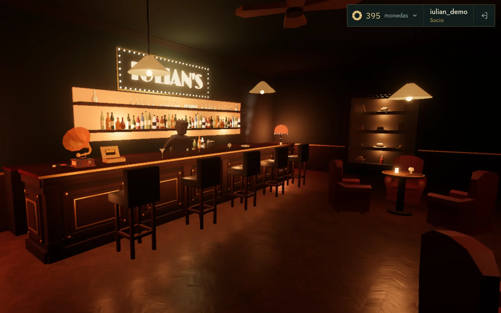
</p>

<p align="center">
  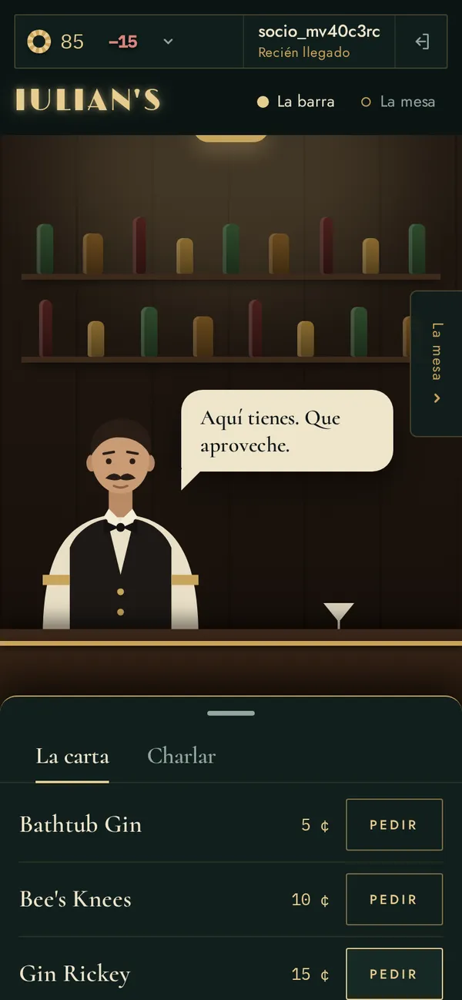
  &nbsp;
  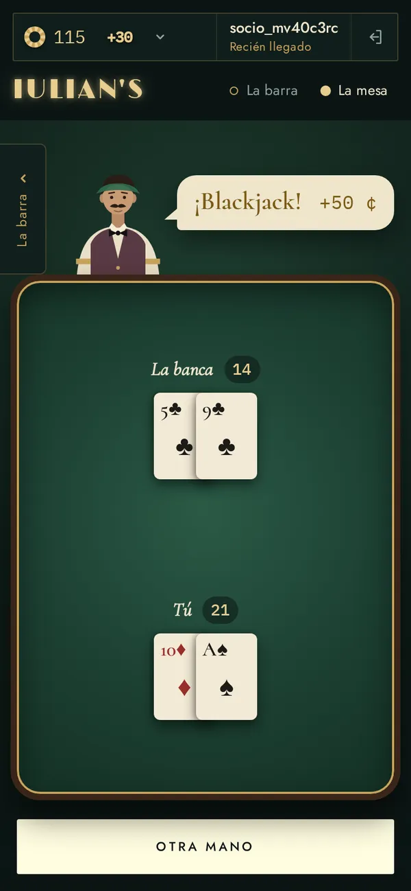
</p>

## Contents

1. [What it is and features](#what-it-is-and-features)
2. [Tech stack](#tech-stack)
3. [Requirements](#requirements)
4. [Getting started](#getting-started)
5. [Scripts](#scripts)
6. [Project structure](#project-structure)
7. [User flow](#user-flow)
8. [Tests](#tests)
9. [Responsive and accessibility](#responsive-and-accessibility)
10. [Design](#design)
11. [Deployment](#deployment)
12. [Project management](#project-management)
13. [Known issues and improvements](#known-issues-and-improvements)
14. [Credits](#credits)
15. [Author](#author)

## What it is and features

This repository is the IulianLounge frontend. It talks to the Spring Boot API in the [backend](https://github.com/iulian640/iulianlounge-backend). The house currency is fictional coins ("monedas" in the Spanish UI). New accounts start with 100.

There are two experiences, and the page picks one on load:

- Desktop: a 3D scene built with Three.js (WebGPU, with WebGL2 as fallback). You move with WASD and the mouse. Near the barman or the blackjack table, press E to order or play.
- Phone and touch tablet (coarse pointer or width under 768 px): a dedicated 2D version with no canvas. It has two rooms, the bar and the table, which you swipe between. It exists because the 3D drained too much battery on phones.

Both share the same logic: Pinia stores and composables. Each mode has its own presentation.

Features:

- Sign up, log in and log out.
- Drinks menu with five cocktails, from 5 to 40 coins.
- Chat with the barman: quick questions with fixed answers, and free text.
- Blackjack with bets of 10, 20 or 50 coins. The dealer stands on 17 and blackjack pays 3:2.
- Balance in the HUD with the change after every move, and an account book with the history.
- Rank based on spending: Recién llegado (newcomer), Cliente, Habitual and Socio (member).
- 50 free coins once a day if your balance is zero.
- Spanish and English with vue-i18n.

## Tech stack

| Area | Technology | Version |
| --- | --- | --- |
| Framework | Vue (Composition API, `<script setup>`, JavaScript) | 3.5 |
| Build | Vite | 8 |
| State | Pinia | 3 |
| Routing | Vue Router | 5 |
| i18n | vue-i18n | 11 |
| 3D | Three.js (WebGPU build) | 0.185 |
| Unit tests | Vitest, Vue Test Utils, jsdom | 4 / 2.4 / 29 |
| E2E tests | Playwright | 1.61.1 |
| Quality | ESLint and oxlint | 10 / 1.69 |
| Formatting | oxfmt | 0.54 |
| Fonts | Limelight, Cormorant, Jost, IBM Plex Mono (`@fontsource`) | |

## Requirements

- Node `^22.18.0` or `>=24.12.0` (CI uses 24).
- npm.
- The backend running on port 8080.

## Getting started

1. Clone both repositories:

   ```bash
   git clone https://github.com/iulian640/iulianlounge-backend.git
   git clone https://github.com/iulian640/iulianlounge-frontend.git
   ```

2. Start the backend first. The steps are in its [README](https://github.com/iulian640/iulianlounge-backend).
3. Install the frontend dependencies and start the dev server:

   ```bash
   cd iulianlounge-frontend
   npm ci
   npm run dev
   ```

4. Open http://localhost:5173.

Notes:

- The dev server proxies `/api` to `http://localhost:8080`. The refresh cookie travels on the same origin, so CORS is not needed.
- WebGPU needs a secure context. `localhost` works, a LAN IP does not.
- If the browser has no WebGPU, the scene falls back to WebGL2.

## Scripts

| Script | What it does |
| --- | --- |
| `npm run dev` | Vite dev server |
| `npm run build` | Production build |
| `npm run preview` | Serves the build locally |
| `npm run test:unit` | Vitest in watch mode |
| `npm run test:coverage` | Vitest once, with coverage report |
| `npm run test:e2e` | Playwright E2E tests |
| `npm run lint` | oxlint and ESLint, both with `--fix`: they modify files |
| `npm run format` | Formats `src/` with oxfmt |

## Project structure

```text
src/
  api/          HTTP client (fetch, errors, session renewal)
  components/
    bar/        Menu, barman, chat and bar window
    blackjack/  Table, hands, cards and bets
    hud/        Balance, name and rank, account book
    salon/      Mobile rooms, bottom sheet and room tabs
  composables/  Shared logic: rooms, barman talk, blackjack round, errors
  i18n/         vue-i18n setup and es.json / en.json texts
  lounge/       3D scene: lights, camera, controls, table, models and decor
  router/       Routes and auth guard
  stores/       Pinia: auth, wallet, bar and blackjack
  views/        AccessView, LoungeView, SalonMovil and PrivacyView
e2e/            Playwright tests (desktop and mobile)
public/         3D models and the presentation (public/presentacion/)
docs/           Screenshots, model credits and notes
```

Unit tests live in `__tests__` folders next to the code they test.

## User flow

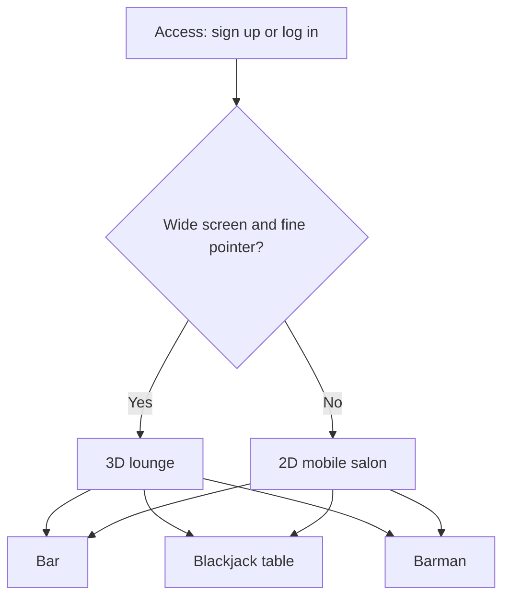

The routes are `/` (the lounge, session required), `/acceso` and `/privacidad`. Without a session, `/` redirects to `/acceso`.

## Tests

```bash
npm run test:unit       # watch mode
npm run test:coverage   # once, with coverage
npm run test:e2e        # needs the backend running
```

- 977 tests in 52 files: 25 component tests with Vue Test Utils and 27 logic tests (stores, composables, API and the 3D scene).
- Line coverage 98.55% (statements 97.86%, branches 92.94%). `vitest.config.js` fails if lines drop below 70%.
- 10 Playwright E2E tests: 4 on desktop (redirect without a session, sign-up with welcome bonus and sign-out, wrong password, and the account book) and 6 on mobile (2D salon instead of 3D, swiping between rooms, drinking down to zero with the house gift, rank up, a full blackjack hand, and sign-out).
- E2E tests run against the production build (`vite build` and `vite preview` on port 5179, with `/api` going to `localhost:8080`).
- The GitHub Actions CI runs `npm ci`, `npm run lint` and `npm run test:coverage` on every push.

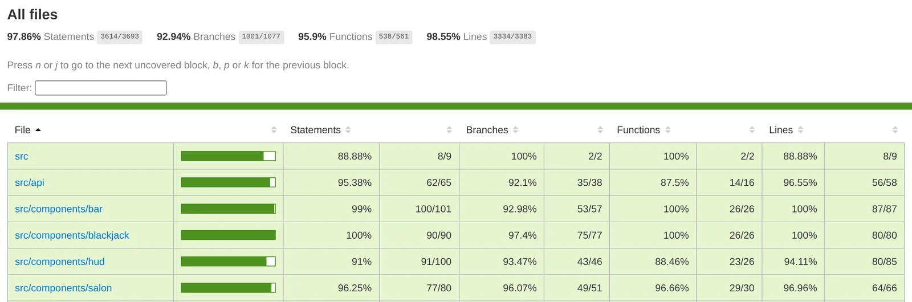

## Responsive and accessibility

The mobile salon is two full-screen rooms with horizontal `scroll-snap`. You switch rooms by swiping, with the edge handles or with the tabs. At the bar, a bottom sheet holds the Menu and Talk tabs.

What the code does:

- 44 px touch targets and 16 px text fields.
- `prefers-reduced-motion` is respected in the components and in the 3D scene.
- Room tabs (`tablist`) that move with the arrow keys.
- `aria-live` regions for the balance and for blackjack.
- No horizontal scroll at 320 px, in portrait and landscape.

| Width | View |
| --- | --- |
| 390 px | Bar, menu, Talk, account book and table |
| 320 px | The bar |
| 667 px (landscape) | The bar and the table |

<p>
  
  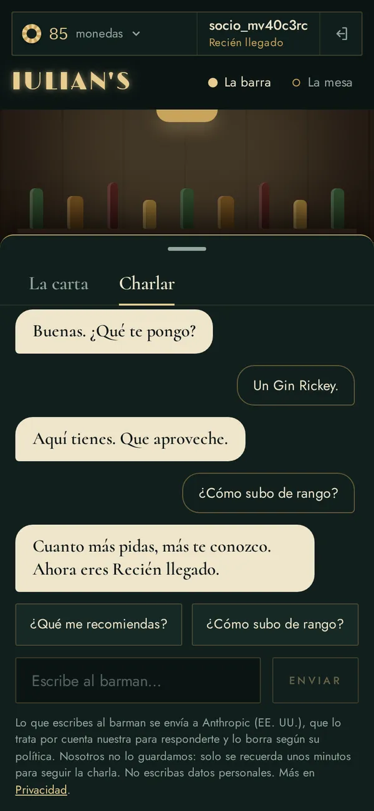
  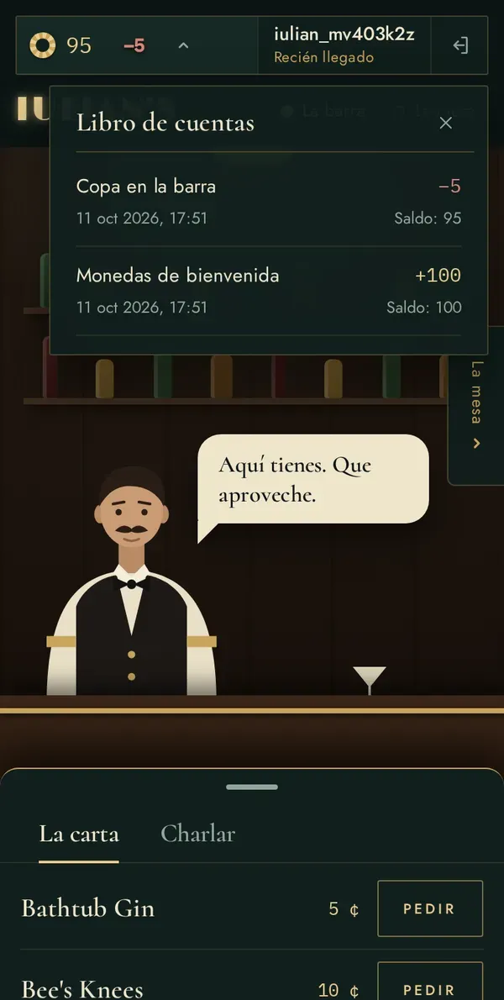
  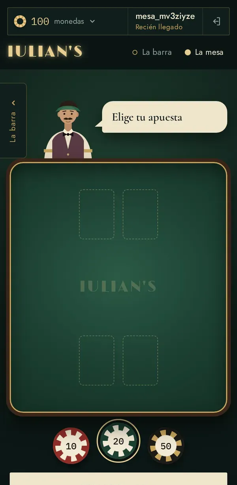
  
  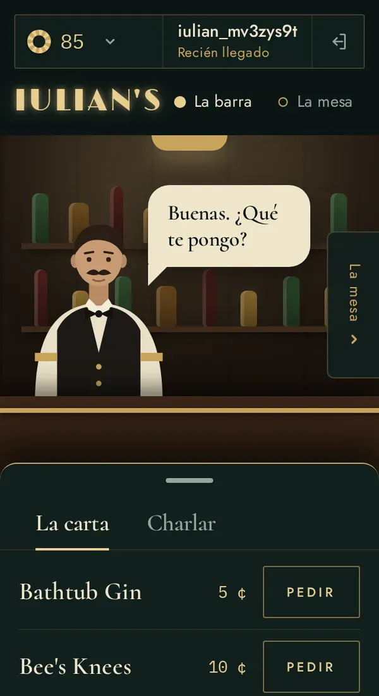
</p>

<p>
  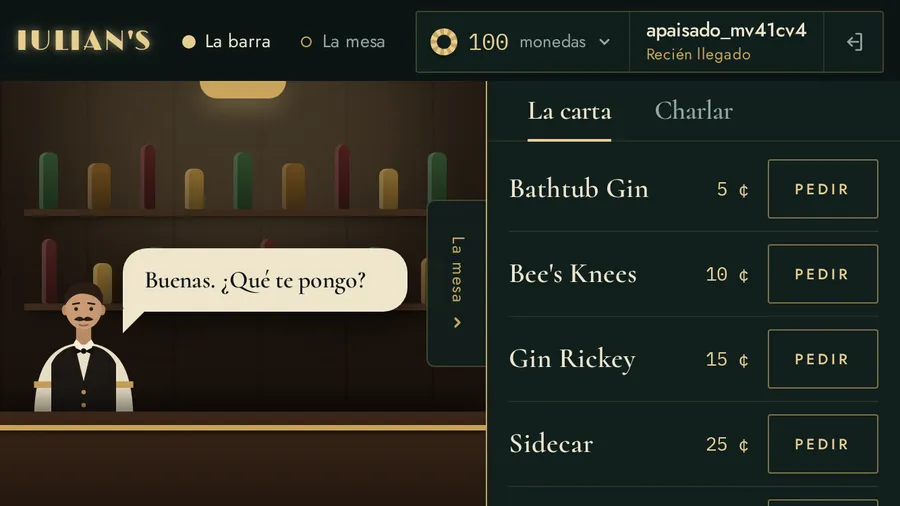
  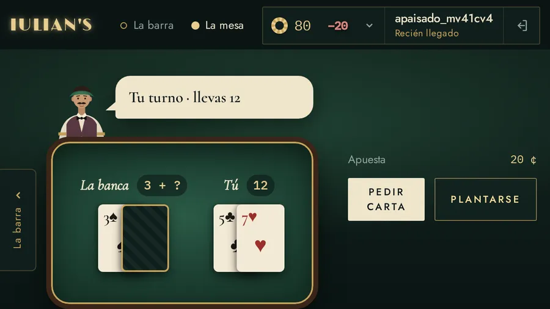
</p>

## Design

Sketches, mockups and a clickable prototype are in [Penpot](https://design.penpot.app/#/view?file-id=52a5041f-08a1-80f1-8008-c797da3e231e&page-id=72937cd6-6e9c-4b4e-991d-639a5ecf7b58&section=interactions&index=0&share-id=d0c6b4b3-247d-4110-95db-19385af7feb2), the open source alternative to Figma. The prototype has two paths: desktop and mobile.

<p align="center">
  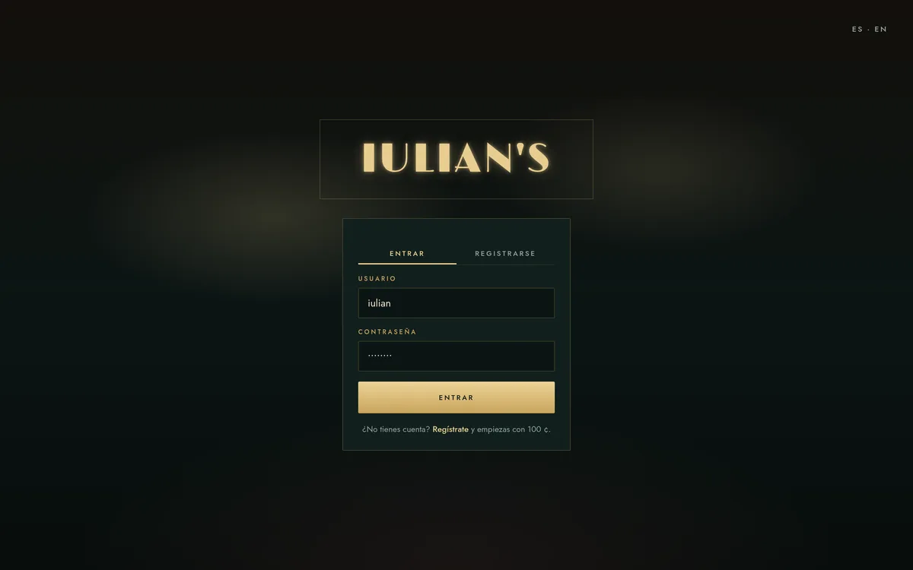
  &nbsp;
  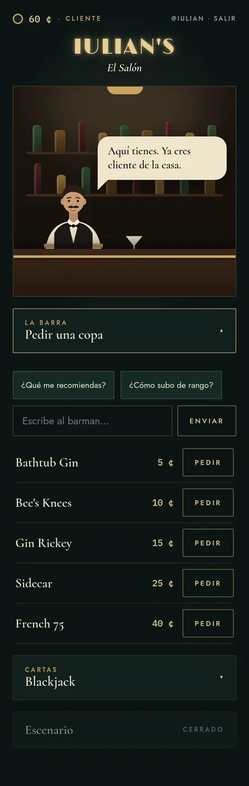
</p>

## Deployment

Caddy serves the build on the same server as the backend and forwards `/api` to it. The setup is in the [backend deploy README](https://github.com/iulian640/iulianlounge-backend/blob/main/deploy/README.md).

The project presentation lives in `public/presentacion/` and is published at [/presentacion/](https://iulianlounge.com/presentacion/).

## Project management

Jira with 50 tasks in 15 epics. One branch per task, and commits carry the task key (`IUL-xx`).

| Sprint | Content | Dates |
| --- | --- | --- |
| 1 | Auth and wallet | 3–17 Jul |
| 8 | Full auth | 16–22 Sep |
| 9 | Wallet, HUD and mobile | 25 Sep–1 Oct |
| 10 | Bar and blackjack | 7–9 Oct |
| 11 | Mobile and delivery | 10–13 Oct |

From July to September I worked on the 3D lounge outside the sprints. That is why the board jumps from sprint 1 to 8.

## Known issues and improvements

- Three.js ships in the main bundle on phones too, where it is not used. Lazy loading is missing.
- On some Linux Chromium builds the 3D scene renders black with WebGPU. It works in Firefox.
- There is no visible language selector. The English texts exist, but the interface starts in Spanish.
- The AI barman is switched off in production. The chat answers with fixed lines.

## Credits

3D models and their licences are listed in [docs/CREDITS.md](docs/CREDITS.md).

## Author

Iulian Timofei · [GitHub](https://github.com/iulian640)
