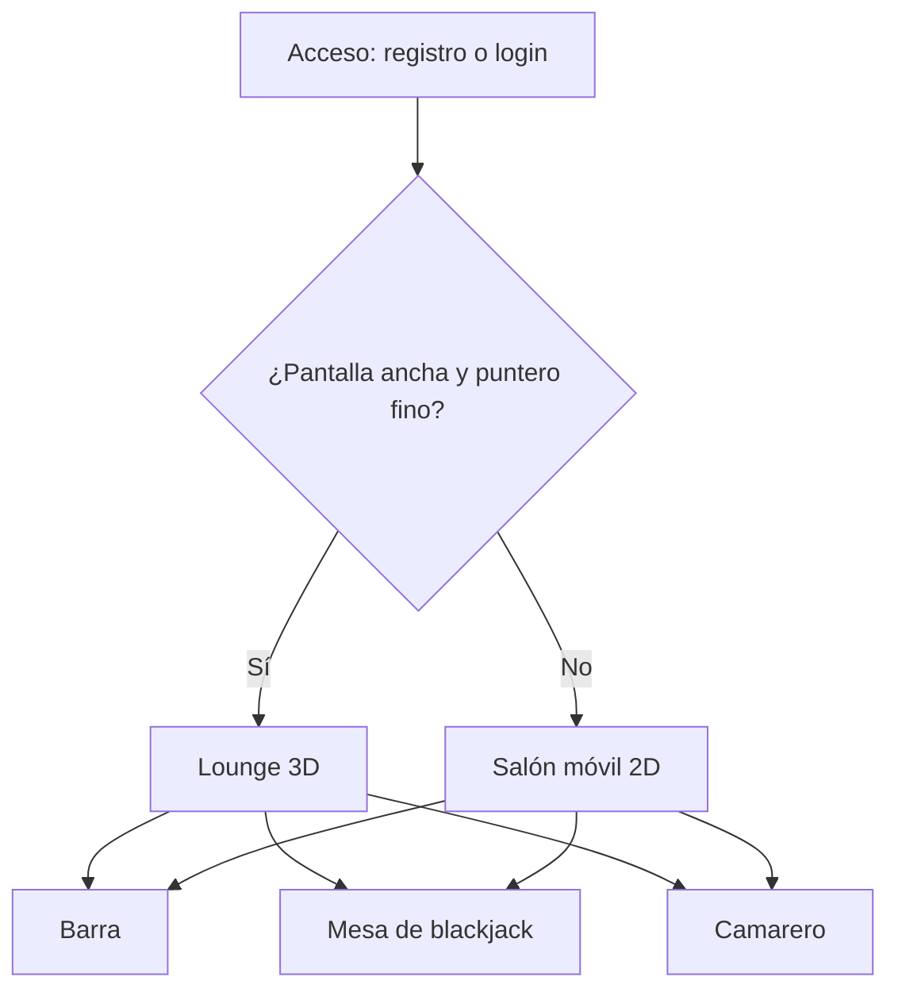

# IulianLounge · Frontend

SPA en Vue 3 de IulianLounge, un bar de los años 20 en el navegador donde se juega con monedas ficticias.


[](https://github.com/iulian640/iulianlounge-frontend/actions/workflows/ci.yml)

[App](https://iulianlounge.com) · [Presentación](https://iulianlounge.com/presentacion/) · [Backend](https://github.com/iulian640/iulianlounge-backend) · [Penpot](https://design.penpot.app/#/view?file-id=52a5041f-08a1-80f1-8008-c797da3e231e&page-id=72937cd6-6e9c-4b4e-991d-639a5ecf7b58&section=interactions&index=0&share-id=d0c6b4b3-247d-4110-95db-19385af7feb2)

[English version](README.en.md)

<p align="center">
  
</p>

<p align="center">
  
  &nbsp;
  
</p>

## Índice

1. [Qué es y funcionalidades](#qué-es-y-funcionalidades)
2. [Tecnologías](#tecnologías)
3. [Requisitos](#requisitos)
4. [Arranque paso a paso](#arranque-paso-a-paso)
5. [Scripts](#scripts)
6. [Estructura del proyecto](#estructura-del-proyecto)
7. [Flujo de usuario](#flujo-de-usuario)
8. [Tests](#tests)
9. [Responsive y accesibilidad](#responsive-y-accesibilidad)
10. [Diseño](#diseño)
11. [Despliegue](#despliegue)
12. [Gestión del proyecto](#gestión-del-proyecto)
13. [Créditos](#créditos)
14. [Autor](#autor)

## Qué es y funcionalidades

Este repositorio es el frontend de IulianLounge. Habla con la API del [backend](https://github.com/iulian640/iulianlounge-backend) en Spring Boot. La moneda de la casa son las monedas, ficticias. Las cuentas nuevas empiezan con 100.

Hay dos experiencias y se elige una al cargar la página:

- Escritorio: una escena 3D con Three.js (WebGPU, con WebGL2 de reserva). Te mueves con WASD y el ratón. Cerca del barman o de la mesa de blackjack, pulsas E para pedir o jugar.
- Móvil y tablet táctil (puntero grueso o ancho menor de 768 px): una versión 2D propia, sin canvas. Tiene dos salas, la barra y la mesa, que se pasan deslizando. Se hizo así porque el 3D gastaba mucha batería en el móvil.

La lógica es la misma en las dos: stores de Pinia y composables compartidos. Cada modo tiene su propia presentación.

Funcionalidades:

- Registro, inicio y cierre de sesión.
- Carta del bar con cinco copas, de 5 a 40 monedas.
- Charla con el camarero: preguntas rápidas con respuesta fija y texto libre.
- Blackjack con apuestas de 10, 20 o 50 monedas. La banca se planta en 17 y el blackjack paga 3:2.
- Saldo en el HUD con el cambio tras cada movimiento y libro de cuentas con el historial.
- Rango según lo gastado: Recién llegado, Cliente, Habitual y Socio.
- 50 monedas gratis una vez al día si el saldo está a cero.
- Castellano e inglés con vue-i18n.

## Tecnologías

| Área | Tecnología | Versión |
| --- | --- | --- |
| Framework | Vue (Composition API, `<script setup>`, JavaScript) | 3.5 |
| Build | Vite | 8 |
| Estado | Pinia | 3 |
| Rutas | Vue Router | 5 |
| Idiomas | vue-i18n | 11 |
| 3D | Three.js (build WebGPU) | 0.185 |
| Tests unitarios | Vitest, Vue Test Utils, jsdom | 4 / 2.4 / 29 |
| Tests E2E | Playwright | 1.61.1 |
| Calidad | ESLint y oxlint | 10 / 1.69 |
| Formato | oxfmt | 0.54 |
| Tipografías | Limelight, Cormorant, Jost, IBM Plex Mono (`@fontsource`) | |

## Requisitos

- Node `^22.18.0` o `>=24.12.0` (el CI usa 24).
- npm.
- El backend arrancado en el puerto 8080.

## Arranque paso a paso

1. Clona los dos repositorios:

   ```bash
   git clone https://github.com/iulian640/iulianlounge-backend.git
   git clone https://github.com/iulian640/iulianlounge-frontend.git
   ```

2. Arranca primero el backend. Los pasos están en su [README](https://github.com/iulian640/iulianlounge-backend).
3. Instala las dependencias del frontend y arranca el servidor de desarrollo:

   ```bash
   cd iulianlounge-frontend
   npm ci
   npm run dev
   ```

4. Abre http://localhost:5173.

Notas:

- El servidor de desarrollo hace proxy de `/api` a `http://localhost:8080`. Así la cookie de refresco viaja por el mismo origen y no hace falta CORS.
- WebGPU necesita un contexto seguro. `localhost` vale, una IP de la red local no.
- Si el navegador no tiene WebGPU, la escena usa WebGL2.

## Scripts

| Script | Qué hace |
| --- | --- |
| `npm run dev` | Servidor de desarrollo de Vite |
| `npm run build` | Build de producción |
| `npm run preview` | Sirve el build en local |
| `npm run test:unit` | Vitest en modo watch |
| `npm run test:coverage` | Vitest una vez, con informe de cobertura |
| `npm run test:e2e` | Tests E2E con Playwright |
| `npm run lint` | oxlint y ESLint, los dos con `--fix`: modifican los ficheros |
| `npm run format` | Formatea `src/` con oxfmt |

## Estructura del proyecto

```text
src/
  api/          Cliente HTTP (fetch, errores, renovación de sesión)
  components/
    bar/        Carta, camarero, chat y ventana de la barra
    blackjack/  Mesa, manos, cartas y apuestas
    hud/        Saldo, nombre y rango, libro de cuentas
    salon/      Salas del móvil, hoja inferior y pestañas de sala
  composables/  Lógica compartida: salas, charla, ronda de blackjack, errores
  i18n/         Configuración de vue-i18n y textos es.json / en.json
  lounge/       Escena 3D: luces, cámara, controles, mesa, modelos y decoración
  router/       Rutas y guarda de autenticación
  stores/       Pinia: auth, wallet, bar y blackjack
  views/        AccessView, LoungeView, SalonMovil y PrivacyView
e2e/            Tests de Playwright (desktop y mobile)
public/         Modelos 3D y la presentación (public/presentacion/)
docs/           Capturas, créditos de los modelos y notas
```

Los tests unitarios viven en carpetas `__tests__` junto al código que prueban.

## Flujo de usuario



Las rutas son `/` (el lounge, solo con sesión), `/acceso` y `/privacidad`. Sin sesión, `/` redirige a `/acceso`.

## Tests

```bash
npm run test:unit       # modo watch
npm run test:coverage   # una vez, con cobertura
npm run test:e2e        # necesita el backend arrancado
```

- 977 tests en 52 ficheros: 25 de componentes con Vue Test Utils y 27 de lógica (stores, composables, API y escena 3D).
- Cobertura de líneas del 98,55 % (sentencias 97,86 %, ramas 92,94 %). `vitest.config.js` falla si las líneas bajan del 70 %.
- 10 tests E2E con Playwright: 4 de escritorio (redirección sin sesión, registro con bono de bienvenida y cierre de sesión, contraseña incorrecta y libro de cuentas) y 6 de móvil (salón 2D en lugar del 3D, deslizar entre salas, beber hasta saldo cero con el regalo de la casa, subida de rango, una mano completa de blackjack y cierre de sesión).
- Los E2E corren contra el build de producción (`vite build` y `vite preview` en el puerto 5179, con `/api` hacia `localhost:8080`).
- El CI de GitHub Actions ejecuta `npm ci`, `npm run lint` y `npm run test:coverage` en cada push.


## Responsive y accesibilidad

El salón móvil son dos salas a pantalla completa con `scroll-snap` horizontal. Se cambia de sala deslizando, con las asas de los bordes o con las pestañas. En la barra, una hoja inferior con las pestañas La carta y Charlar.

Lo que hay en el código:

- Objetivos táctiles de 44 px y campos de texto de 16 px.
- `prefers-reduced-motion` respetado en los componentes y en la escena 3D.
- Pestañas de sala (`tablist`) que se mueven con las flechas del teclado.
- Regiones `aria-live` para el saldo y para el blackjack.
- Sin scroll horizontal a 320 px, en vertical y en apaisado.

| Ancho | Vista |
| --- | --- |
| 390 px | La barra, la carta, Charlar, libro de cuentas y mesa |
| 320 px | La barra |
| 667 px (apaisado) | La barra y la mesa |

<p>
  
  
  
  
  
  
</p>

<p>
  
  
</p>

## Diseño

Bocetos, mockups y prototipo navegable en [Penpot](https://design.penpot.app/#/view?file-id=52a5041f-08a1-80f1-8008-c797da3e231e&page-id=72937cd6-6e9c-4b4e-991d-639a5ecf7b58&section=interactions&index=0&share-id=d0c6b4b3-247d-4110-95db-19385af7feb2), la alternativa libre a Figma. El prototipo tiene dos recorridos: escritorio y móvil.

<p align="center">
  
  &nbsp;
  
</p>

## Despliegue

El build lo sirve Caddy, en el mismo servidor que el backend, y Caddy reenvía `/api` al backend. La configuración está en el [README de despliegue del backend](https://github.com/iulian640/iulianlounge-backend/blob/main/deploy/README.md).

La presentación del proyecto vive en `public/presentacion/` y se publica en [/presentacion/](https://iulianlounge.com/presentacion/).

## Gestión del proyecto

Jira con 50 tareas en 15 épicas. Una rama por tarea y commits con la clave de la tarea (`IUL-xx`).

| Sprint | Contenido | Fechas |
| --- | --- | --- |
| 1 | Auth y cartera | 3–17 jul |
| 8 | Auth completa | 16–22 sep |
| 9 | Cartera, HUD y móvil | 25 sep–1 oct |
| 10 | Barra y blackjack | 7–9 oct |
| 11 | Móvil y entrega | 10–13 oct |

De julio a septiembre trabajé en el lounge 3D fuera de los sprints. Por eso el tablero salta del sprint 1 al 8.

## Créditos

Los modelos 3D y sus licencias están en [docs/CREDITS.md](docs/CREDITS.md).

## Autor

Iulian Timofei · [GitHub](https://github.com/iulian640)
